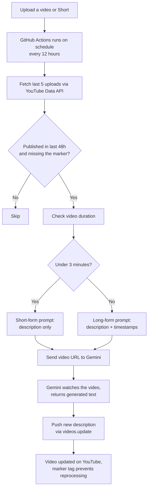

For a while now, every time I uploaded a video, I'd do the same annoying dance: open YouTube Studio, grab the video link, paste it into Gemini, ask it to write a description and timestamps, wait, copy the output, paste it back into the editor, publish. Every single video. Every single time.

It's not hard. It's just tedious, and tedious things are exactly the kind of thing that quietly stop happening once you're busy or tired or just don't feel like doing five extra steps after already editing and uploading a video. So I decided to just automate the whole thing.

## The actual problem

Good descriptions and timestamps aren't optional if you actually care about the channel growing. They help with discoverability, they make the video easier to navigate, and honestly they just make a channel look more put-together. For a bigger channel with a team and an editor whose whole job is publishing, this isn't a problem — someone just does it. For a smaller channel like mine, where it's basically just me handling everything after the video is shot and edited, it's one more manual step competing for time and attention, and manual steps are where consistency goes to die.

So the real problem wasn't "how do I write a description" — Gemini already handled that part fine. The problem was that a good process which depends on me remembering to do it by hand, every single time, isn't really a process at all.

## What I built

Nothing fancy, honestly — and I want to be upfront about that. This is just a script gluing together two APIs. But the fact that it's simple doesn't mean it doesn't matter. Small automations like this are underrated exactly because the problem they solve is small and repetitive rather than big and dramatic — but repetitive is precisely the kind of thing that's worth removing from your plate.

Here's roughly how it works:

- A **GitHub Actions workflow** runs on a schedule, every 12 hours, for free, without me needing a server running anywhere.
- It checks my channel's most recent uploads through the **YouTube Data API** and looks at which ones don't already have a description with a specific marker in it — that marker is how it knows a video's already been handled, so it never touches the same video twice.
- For anything new, it hands the video's URL straight to **Gemini**, which can watch a public YouTube video directly from its URL — no downloading, no processing on my end.
- It checks the video's duration first. If it's a Short, it gets a short, punchy description with no timestamps, because timestamps on a 40-second video don't make sense. If it's a long-form video, it gets a full description plus a proper timestamped chapter list.
- Once Gemini generates the text, the script pushes it straight back to YouTube through the API, and the video's live description just... updates itself.

That's it. No dashboard, no app, nothing I need to check in on. I upload, and somewhere in the next 12 hours, the description handles itself.

## The file structure

Deliberately minimal — two files that matter, plus the usual repo scaffolding:

```
youtube-auto-descriptions/
├── .github/
│   └── workflows/
│       └── auto-describe.yml   # tells GitHub when and how to run it
├── script.py                    # the actual pipeline logic
└── .gitignore                   # keeps client_secret.json and token.json out of git
```

Two files never get committed, on purpose:

- `client_secret.json` — the OAuth client credentials, only ever needed locally to generate a token
- `token.json` — the actual access/refresh token for my YouTube account, which instead lives as a GitHub secret, not a file in the repo

## How it actually flows



Nothing in that chain needs me to be present. The only human step is the one at the very top — upload the video like I always have — and everything after that happens on its own.

I'll say this plainly: there's nothing technically impressive here. It's a couple of API calls stitched together with some basic logic. If you showed this to someone and asked "is this hard," the honest answer is no.

But I don't think impact and difficulty are the same thing. A high-quality description, a proper timestamp breakdown, the right hashtags — these genuinely affect how discoverable a video is and how professional a channel feels to someone landing on it for the first time. And for a small channel that doesn't have the luxury of a dedicated person handling publishing, doing all of that manually after every single upload gets old fast, and "gets old fast" is usually where good habits quietly fall apart.

What this project actually does is take something that was always worth doing, but easy to skip when you're tired, and puts it on autopilot. The channel ends up looking more polished and put-together, without me having to think about it after I hit upload. That's the whole point — not the cleverness of the code, just that one less thing has to depend on me remembering to do it.

## If you want to run this yourself

The code is simple, but there's a bit of one-time setup on Google's side before any of it works. Here's the short version:

**1. Google Cloud + YouTube API access**

- Create a project at [console.cloud.google.com](https://console.cloud.google.com/), enable the YouTube Data API v3.
- Under APIs & Services > Google Auth Platform, create an OAuth client of type "Desktop app" — this is what lets the script authenticate as your channel from your own machine, no public server needed.
- Run the script once locally with an auth flag to go through the login/consent flow. It'll save a token file — that's what gets reused by the automation from then on.

**2. Gemini API key**

- Grab a free key from [aistudio.google.com/apikey](https://aistudio.google.com/apikey). No billing needed for the free tier.

**3. Wire it into GitHub Actions**

- Push the script and the workflow file to a repo.
- Add your Gemini key and the token file's contents as encrypted repo secrets — never commit either as an actual file.
- Trigger the workflow once manually to confirm it works, then let the schedule take over.

One thing worth knowing going in: while your app is in "Testing" mode on Google's side, only accounts you've explicitly added as test users can authenticate, and refresh tokens can expire after a week. Publishing the app (a couple of clicks, not a full review) removes both of those limits — worth doing if you actually intend to leave this running long-term instead of just trying it out.